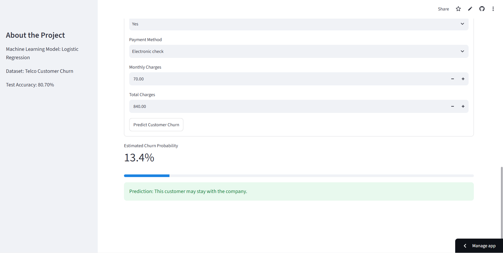

# Customer Churn Prediction System

A machine learning project that predicts whether a telecommunications customer is likely to leave a service. It compares Logistic Regression and Random Forest models and provides an interactive prediction interface using Streamlit.

🚀 **Live Demo:** [Try the Customer Churn Prediction App](https://customer-churn-prediction-ipdvhxvum2ulghr2aksj44.streamlit.app/)

💻 **Source Code:** [View on GitHub](https://github.com/yeddularushi-022/customer-churn-prediction)

## Project Overview

Customer churn is an important business problem because losing customers can affect revenue and growth. This project uses customer account and service information to predict churn and help identify customers who may need retention support.

## Features

- Data preprocessing and feature encoding
- Logistic Regression and Random Forest model comparison
- Model evaluation using Accuracy, Precision, Recall, F1 Score, and ROC-AUC
- Interactive Streamlit web application
- Churn prediction with estimated probability
- Model performance visualization

## Technologies Used

- Python
- Pandas and NumPy
- Scikit-learn
- Matplotlib and Seaborn
- Streamlit
- Joblib

## Application Preview

The application provides an interactive interface for entering customer information and obtaining a churn prediction.



**Example Prediction:** The application estimates the customer's churn probability and displays a prediction based on the entered information.
## Model Performance

The models were evaluated on a held-out test set containing 20% of the dataset.

| Metric | Logistic Regression | Random Forest |
|---|---:|---:|
| Accuracy | 80.70% | 77.43% |
| Precision | 65.84% | 56.60% |
| Recall | 56.68% | 64.17% |
| F1 Score | 60.92% | 60.15% |
| ROC-AUC | 0.8418 | 0.8275 |

Logistic Regression achieved higher accuracy, precision, F1 Score, and ROC-AUC in this evaluation. Random Forest achieved higher recall for churn customers.

The preferred model depends on the business objective and the cost of missing a customer who may churn. For example, a business focused on identifying as many potential churners as possible may prioritize recall.

## Project Structure

```text
customer-churn-prediction/
├── app.py
├── main.py
├── churn_model.pkl
├── model_comparison.png
├── requirements.txt
├── README.md
└── .gitignore
```

The dataset is excluded from this repository. Obtain the dataset from its original source and place the CSV file in the project folder before running the training script.

## Installation and Setup

### 1. Clone the Repository

```bash
git clone https://github.com/yeddularushi-022/customer-churn-prediction.git
cd customer-churn-prediction
```

### 2. Install Dependencies

```bash
py -m pip install -r requirements.txt
```

### 3. Prepare the Dataset

Place `WA_Fn-UseC_-Telco-Customer-Churn.csv` in the project folder.

Ensure that you obtain and use the dataset in accordance with its source's terms.

### 4. Train the Model

```bash
py main.py
```

### 5. Run the Streamlit Application

```bash
py -m streamlit run app.py
```

The application will usually open in your browser at:

`http://localhost:8501`


## Future Improvements

- Improve churn recall and model calibration.
- Add explainability for individual predictions.
- Test the model on additional datasets.
- Explore hyperparameter tuning to improve model performance.

## Disclaimer

This project is for educational and demonstration purposes. Predictions are estimates and should not be treated as guaranteed outcomes.

## Author

**Rushi Yeddula**

- GitHub: [@yeddularushi-022](https://github.com/yeddularushi-022)
- LinkedIn: [Yeddula Rushi](https://www.linkedin.com/in/yeddula-rushi-77a947434/)

---

*Built as a practical machine learning project to explore customer churn prediction and model evaluation.*
